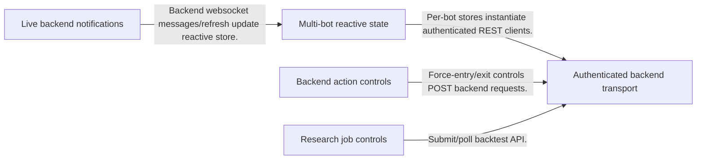
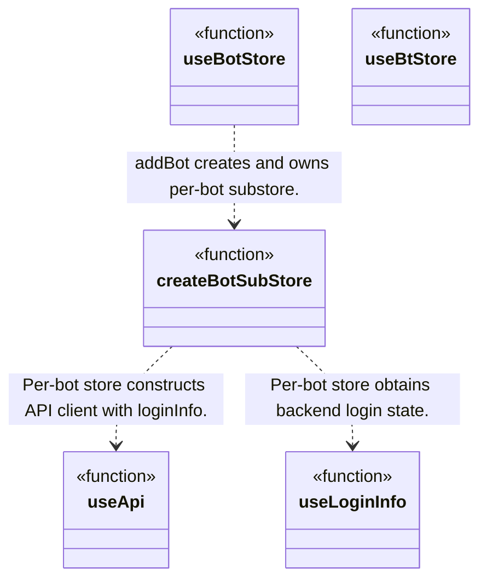
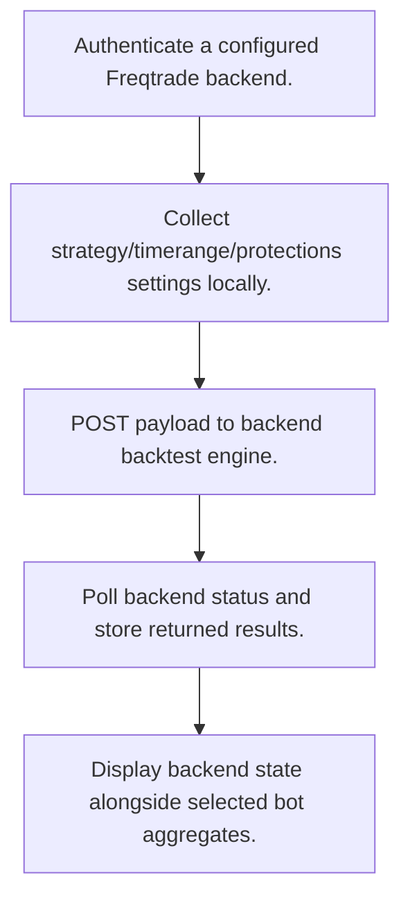
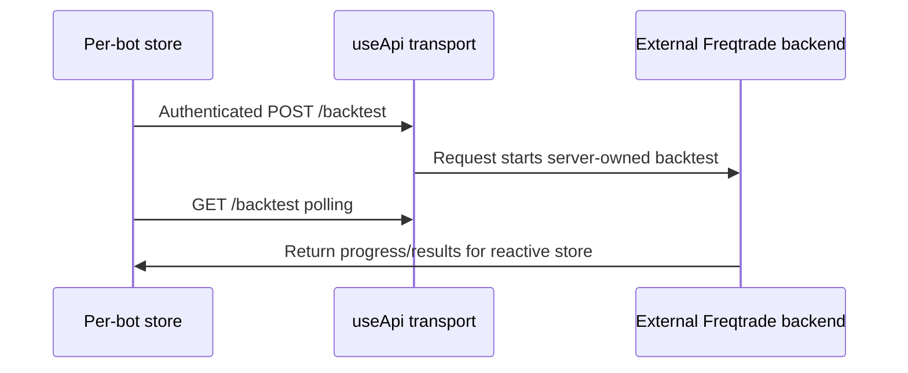

# frequi: workflow, design and architecture

Updated: **2026-10-13**
Reviewed Git hash: `8e4b2a6f710e9eb6a58616729f491c50200fbf08`
Branch: `feature/ayu_develop`
Source diff SHA256: `e3b0c44298fc1c149afbf4c8996fb92427ae41e4649b934ca495991b7852b855`
Scope: **Web client / trading dashboard** / Maintenance: **companion**
Languages: TypeScript, Vue, CSS

[HTML edition](ayu-develop.html) / [Development](development.md) / [Historical validation](validation.md) / [Full system comparison](../../docs/index.html)

## Purpose and scope

Operate and inspect Freqtrade bot backends, aggregate selected bots, request research jobs and display trades/candles through REST and WebSocket APIs.

## Features and support boundaries

Native = implemented here. Integration = supplied through a named host/API. Limited = material restriction. Not provided = evidenced scope exclusion. Unverified = support/absence not established. Not applicable = outside this artifact type.

| Capability | Status | Implementation and limits | Source |
|---|---|---|---|
| Backtesting | Integration | Backend Freqtrade supplies market/trading/research semantics; UI requests actions and displays API-returned state/results. | [forceentry](../src/stores/ftbot.ts) ([L1043](https://github.com/alexcwyu/frequi/blob/8e4b2a6f710e9eb6a58616729f491c50200fbf08/src/stores/ftbot.ts#L1043)) / [forceexit](../src/stores/ftbot.ts) ([L1032](https://github.com/alexcwyu/frequi/blob/8e4b2a6f710e9eb6a58616729f491c50200fbf08/src/stores/ftbot.ts#L1032)) / [startBacktest](../src/stores/ftbot.ts) ([L1167](https://github.com/alexcwyu/frequi/blob/8e4b2a6f710e9eb6a58616729f491c50200fbf08/src/stores/ftbot.ts#L1167)) / [pollBacktest](../src/stores/ftbot.ts) ([L1176](https://github.com/alexcwyu/frequi/blob/8e4b2a6f710e9eb6a58616729f491c50200fbf08/src/stores/ftbot.ts#L1176)) / [createBotSubStore](../src/stores/ftbot.ts) ([L74](https://github.com/alexcwyu/frequi/blob/8e4b2a6f710e9eb6a58616729f491c50200fbf08/src/stores/ftbot.ts#L74)) |
| Live execution | Integration | Backend Freqtrade supplies market/trading/research semantics; UI requests actions and displays API-returned state/results. | [forceentry](../src/stores/ftbot.ts) ([L1043](https://github.com/alexcwyu/frequi/blob/8e4b2a6f710e9eb6a58616729f491c50200fbf08/src/stores/ftbot.ts#L1043)) / [forceexit](../src/stores/ftbot.ts) ([L1032](https://github.com/alexcwyu/frequi/blob/8e4b2a6f710e9eb6a58616729f491c50200fbf08/src/stores/ftbot.ts#L1032)) / [startBacktest](../src/stores/ftbot.ts) ([L1167](https://github.com/alexcwyu/frequi/blob/8e4b2a6f710e9eb6a58616729f491c50200fbf08/src/stores/ftbot.ts#L1167)) / [pollBacktest](../src/stores/ftbot.ts) ([L1176](https://github.com/alexcwyu/frequi/blob/8e4b2a6f710e9eb6a58616729f491c50200fbf08/src/stores/ftbot.ts#L1176)) / [createBotSubStore](../src/stores/ftbot.ts) ([L74](https://github.com/alexcwyu/frequi/blob/8e4b2a6f710e9eb6a58616729f491c50200fbf08/src/stores/ftbot.ts#L74)) |
| Paper trading | Integration | Backend Freqtrade supplies market/trading/research semantics; UI requests actions and displays API-returned state/results. | [forceentry](../src/stores/ftbot.ts) ([L1043](https://github.com/alexcwyu/frequi/blob/8e4b2a6f710e9eb6a58616729f491c50200fbf08/src/stores/ftbot.ts#L1043)) / [forceexit](../src/stores/ftbot.ts) ([L1032](https://github.com/alexcwyu/frequi/blob/8e4b2a6f710e9eb6a58616729f491c50200fbf08/src/stores/ftbot.ts#L1032)) / [startBacktest](../src/stores/ftbot.ts) ([L1167](https://github.com/alexcwyu/frequi/blob/8e4b2a6f710e9eb6a58616729f491c50200fbf08/src/stores/ftbot.ts#L1167)) / [pollBacktest](../src/stores/ftbot.ts) ([L1176](https://github.com/alexcwyu/frequi/blob/8e4b2a6f710e9eb6a58616729f491c50200fbf08/src/stores/ftbot.ts#L1176)) / [createBotSubStore](../src/stores/ftbot.ts) ([L74](https://github.com/alexcwyu/frequi/blob/8e4b2a6f710e9eb6a58616729f491c50200fbf08/src/stores/ftbot.ts#L74)) |
| Event driven | Integration | Consumes feature-gated backend WebSocket trade/candle notifications, not native exchange market data. | [startWebSocket](../src/stores/ftbot.ts) ([L1388](https://github.com/alexcwyu/frequi/blob/8e4b2a6f710e9eb6a58616729f491c50200fbf08/src/stores/ftbot.ts#L1388)) |
| Vectorized | Unverified | Representative source review did not establish this capability; no claim of absence. | Not applicable to this repository scope. |
| Order management | Integration | Backend Freqtrade supplies market/trading/research semantics; UI requests actions and displays API-returned state/results. | [forceentry](../src/stores/ftbot.ts) ([L1043](https://github.com/alexcwyu/frequi/blob/8e4b2a6f710e9eb6a58616729f491c50200fbf08/src/stores/ftbot.ts#L1043)) / [forceexit](../src/stores/ftbot.ts) ([L1032](https://github.com/alexcwyu/frequi/blob/8e4b2a6f710e9eb6a58616729f491c50200fbf08/src/stores/ftbot.ts#L1032)) / [startBacktest](../src/stores/ftbot.ts) ([L1167](https://github.com/alexcwyu/frequi/blob/8e4b2a6f710e9eb6a58616729f491c50200fbf08/src/stores/ftbot.ts#L1167)) / [pollBacktest](../src/stores/ftbot.ts) ([L1176](https://github.com/alexcwyu/frequi/blob/8e4b2a6f710e9eb6a58616729f491c50200fbf08/src/stores/ftbot.ts#L1176)) / [createBotSubStore](../src/stores/ftbot.ts) ([L74](https://github.com/alexcwyu/frequi/blob/8e4b2a6f710e9eb6a58616729f491c50200fbf08/src/stores/ftbot.ts#L74)) |
| Order types | Integration | Backend Freqtrade supplies market/trading/research semantics; UI requests actions and displays API-returned state/results. | [forceentry](../src/stores/ftbot.ts) ([L1043](https://github.com/alexcwyu/frequi/blob/8e4b2a6f710e9eb6a58616729f491c50200fbf08/src/stores/ftbot.ts#L1043)) / [forceexit](../src/stores/ftbot.ts) ([L1032](https://github.com/alexcwyu/frequi/blob/8e4b2a6f710e9eb6a58616729f491c50200fbf08/src/stores/ftbot.ts#L1032)) / [startBacktest](../src/stores/ftbot.ts) ([L1167](https://github.com/alexcwyu/frequi/blob/8e4b2a6f710e9eb6a58616729f491c50200fbf08/src/stores/ftbot.ts#L1167)) / [pollBacktest](../src/stores/ftbot.ts) ([L1176](https://github.com/alexcwyu/frequi/blob/8e4b2a6f710e9eb6a58616729f491c50200fbf08/src/stores/ftbot.ts#L1176)) / [createBotSubStore](../src/stores/ftbot.ts) ([L74](https://github.com/alexcwyu/frequi/blob/8e4b2a6f710e9eb6a58616729f491c50200fbf08/src/stores/ftbot.ts#L74)) |
| Multi venue | Limited | Multi-bot frontend may monitor distinct configured venues; it does not coordinate a multi-venue order engine. | [useBotStore](../src/stores/ftbotwrapper.ts) ([L84](https://github.com/alexcwyu/frequi/blob/8e4b2a6f710e9eb6a58616729f491c50200fbf08/src/stores/ftbotwrapper.ts#L84)) / [addBot](../src/stores/ftbotwrapper.ts) ([L291](https://github.com/alexcwyu/frequi/blob/8e4b2a6f710e9eb6a58616729f491c50200fbf08/src/stores/ftbotwrapper.ts#L291)) |
| Crypto | Integration | Backend Freqtrade supplies market/trading/research semantics; UI requests actions and displays API-returned state/results. | [forceentry](../src/stores/ftbot.ts) ([L1043](https://github.com/alexcwyu/frequi/blob/8e4b2a6f710e9eb6a58616729f491c50200fbf08/src/stores/ftbot.ts#L1043)) / [forceexit](../src/stores/ftbot.ts) ([L1032](https://github.com/alexcwyu/frequi/blob/8e4b2a6f710e9eb6a58616729f491c50200fbf08/src/stores/ftbot.ts#L1032)) / [startBacktest](../src/stores/ftbot.ts) ([L1167](https://github.com/alexcwyu/frequi/blob/8e4b2a6f710e9eb6a58616729f491c50200fbf08/src/stores/ftbot.ts#L1167)) / [pollBacktest](../src/stores/ftbot.ts) ([L1176](https://github.com/alexcwyu/frequi/blob/8e4b2a6f710e9eb6a58616729f491c50200fbf08/src/stores/ftbot.ts#L1176)) / [createBotSubStore](../src/stores/ftbot.ts) ([L74](https://github.com/alexcwyu/frequi/blob/8e4b2a6f710e9eb6a58616729f491c50200fbf08/src/stores/ftbot.ts#L74)) |
| Equities | Unverified | Representative source review did not establish this capability; no claim of absence. | Not applicable to this repository scope. |
| Futures | Integration | Backend Freqtrade supplies market/trading/research semantics; UI requests actions and displays API-returned state/results. | [forceentry](../src/stores/ftbot.ts) ([L1043](https://github.com/alexcwyu/frequi/blob/8e4b2a6f710e9eb6a58616729f491c50200fbf08/src/stores/ftbot.ts#L1043)) / [forceexit](../src/stores/ftbot.ts) ([L1032](https://github.com/alexcwyu/frequi/blob/8e4b2a6f710e9eb6a58616729f491c50200fbf08/src/stores/ftbot.ts#L1032)) / [startBacktest](../src/stores/ftbot.ts) ([L1167](https://github.com/alexcwyu/frequi/blob/8e4b2a6f710e9eb6a58616729f491c50200fbf08/src/stores/ftbot.ts#L1167)) / [pollBacktest](../src/stores/ftbot.ts) ([L1176](https://github.com/alexcwyu/frequi/blob/8e4b2a6f710e9eb6a58616729f491c50200fbf08/src/stores/ftbot.ts#L1176)) / [createBotSubStore](../src/stores/ftbot.ts) ([L74](https://github.com/alexcwyu/frequi/blob/8e4b2a6f710e9eb6a58616729f491c50200fbf08/src/stores/ftbot.ts#L74)) |
| Options | Unverified | Representative source review did not establish this capability; no claim of absence. | Not applicable to this repository scope. |
| Forex | Unverified | Representative source review did not establish this capability; no claim of absence. | Not applicable to this repository scope. |
| Strategy api | Integration | Strategy names/settings are backend API objects; frontend does not define the Python strategy runtime. | [useBtStore](../src/stores/btStore.ts) ([L3](https://github.com/alexcwyu/frequi/blob/8e4b2a6f710e9eb6a58616729f491c50200fbf08/src/stores/btStore.ts#L3)) / [createBotSubStore](../src/stores/ftbot.ts) ([L74](https://github.com/alexcwyu/frequi/blob/8e4b2a6f710e9eb6a58616729f491c50200fbf08/src/stores/ftbot.ts#L74)) |
| Optimization | Limited | UI fetches hyperopt-loss metadata; reviewed controls do not establish a native optimizer or complete optimizer job flow. | [createBotSubStore](../src/stores/ftbot.ts) ([L74](https://github.com/alexcwyu/frequi/blob/8e4b2a6f710e9eb6a58616729f491c50200fbf08/src/stores/ftbot.ts#L74)) |
| Machine learning | Integration | Backtest UI holds FreqAI model/identifier settings; model training/inference belongs to backend. | [useBtStore](../src/stores/btStore.ts) ([L3](https://github.com/alexcwyu/frequi/blob/8e4b2a6f710e9eb6a58616729f491c50200fbf08/src/stores/btStore.ts#L3)) |
| Reinforcement learning | Unverified | Representative source review did not establish this capability; no claim of absence. | Not applicable to this repository scope. |
| Portfolio | Integration | Backend Freqtrade supplies market/trading/research semantics; UI requests actions and displays API-returned state/results. | [forceentry](../src/stores/ftbot.ts) ([L1043](https://github.com/alexcwyu/frequi/blob/8e4b2a6f710e9eb6a58616729f491c50200fbf08/src/stores/ftbot.ts#L1043)) / [forceexit](../src/stores/ftbot.ts) ([L1032](https://github.com/alexcwyu/frequi/blob/8e4b2a6f710e9eb6a58616729f491c50200fbf08/src/stores/ftbot.ts#L1032)) / [startBacktest](../src/stores/ftbot.ts) ([L1167](https://github.com/alexcwyu/frequi/blob/8e4b2a6f710e9eb6a58616729f491c50200fbf08/src/stores/ftbot.ts#L1167)) / [pollBacktest](../src/stores/ftbot.ts) ([L1176](https://github.com/alexcwyu/frequi/blob/8e4b2a6f710e9eb6a58616729f491c50200fbf08/src/stores/ftbot.ts#L1176)) / [createBotSubStore](../src/stores/ftbot.ts) ([L74](https://github.com/alexcwyu/frequi/blob/8e4b2a6f710e9eb6a58616729f491c50200fbf08/src/stores/ftbot.ts#L74)) |
| Risk management | Integration | Backend Freqtrade supplies market/trading/research semantics; UI requests actions and displays API-returned state/results. | [forceentry](../src/stores/ftbot.ts) ([L1043](https://github.com/alexcwyu/frequi/blob/8e4b2a6f710e9eb6a58616729f491c50200fbf08/src/stores/ftbot.ts#L1043)) / [forceexit](../src/stores/ftbot.ts) ([L1032](https://github.com/alexcwyu/frequi/blob/8e4b2a6f710e9eb6a58616729f491c50200fbf08/src/stores/ftbot.ts#L1032)) / [startBacktest](../src/stores/ftbot.ts) ([L1167](https://github.com/alexcwyu/frequi/blob/8e4b2a6f710e9eb6a58616729f491c50200fbf08/src/stores/ftbot.ts#L1167)) / [pollBacktest](../src/stores/ftbot.ts) ([L1176](https://github.com/alexcwyu/frequi/blob/8e4b2a6f710e9eb6a58616729f491c50200fbf08/src/stores/ftbot.ts#L1176)) / [createBotSubStore](../src/stores/ftbot.ts) ([L74](https://github.com/alexcwyu/frequi/blob/8e4b2a6f710e9eb6a58616729f491c50200fbf08/src/stores/ftbot.ts#L74)) |
| Performance analytics | Integration | Backend Freqtrade supplies market/trading/research semantics; UI requests actions and displays API-returned state/results. | [forceentry](../src/stores/ftbot.ts) ([L1043](https://github.com/alexcwyu/frequi/blob/8e4b2a6f710e9eb6a58616729f491c50200fbf08/src/stores/ftbot.ts#L1043)) / [forceexit](../src/stores/ftbot.ts) ([L1032](https://github.com/alexcwyu/frequi/blob/8e4b2a6f710e9eb6a58616729f491c50200fbf08/src/stores/ftbot.ts#L1032)) / [startBacktest](../src/stores/ftbot.ts) ([L1167](https://github.com/alexcwyu/frequi/blob/8e4b2a6f710e9eb6a58616729f491c50200fbf08/src/stores/ftbot.ts#L1167)) / [pollBacktest](../src/stores/ftbot.ts) ([L1176](https://github.com/alexcwyu/frequi/blob/8e4b2a6f710e9eb6a58616729f491c50200fbf08/src/stores/ftbot.ts#L1176)) / [createBotSubStore](../src/stores/ftbot.ts) ([L74](https://github.com/alexcwyu/frequi/blob/8e4b2a6f710e9eb6a58616729f491c50200fbf08/src/stores/ftbot.ts#L74)) |
| Historical data | Integration | Backend Freqtrade supplies market/trading/research semantics; UI requests actions and displays API-returned state/results. | [forceentry](../src/stores/ftbot.ts) ([L1043](https://github.com/alexcwyu/frequi/blob/8e4b2a6f710e9eb6a58616729f491c50200fbf08/src/stores/ftbot.ts#L1043)) / [forceexit](../src/stores/ftbot.ts) ([L1032](https://github.com/alexcwyu/frequi/blob/8e4b2a6f710e9eb6a58616729f491c50200fbf08/src/stores/ftbot.ts#L1032)) / [startBacktest](../src/stores/ftbot.ts) ([L1167](https://github.com/alexcwyu/frequi/blob/8e4b2a6f710e9eb6a58616729f491c50200fbf08/src/stores/ftbot.ts#L1167)) / [pollBacktest](../src/stores/ftbot.ts) ([L1176](https://github.com/alexcwyu/frequi/blob/8e4b2a6f710e9eb6a58616729f491c50200fbf08/src/stores/ftbot.ts#L1176)) / [createBotSubStore](../src/stores/ftbot.ts) ([L74](https://github.com/alexcwyu/frequi/blob/8e4b2a6f710e9eb6a58616729f491c50200fbf08/src/stores/ftbot.ts#L74)) |
| Streaming data | Integration | Consumes feature-gated backend WebSocket trade/candle notifications, not native exchange market data. | [startWebSocket](../src/stores/ftbot.ts) ([L1388](https://github.com/alexcwyu/frequi/blob/8e4b2a6f710e9eb6a58616729f491c50200fbf08/src/stores/ftbot.ts#L1388)) |
| Persistence | Limited | Native browser storage persists authentication and bot configuration via useStorage; durable trade/history/backtest result persistence belongs to integrated Freqtrade backend, not a local trading ledger. | [allLoginInfos](../src/composables/loginInfo.ts) ([L16](https://github.com/alexcwyu/frequi/blob/8e4b2a6f710e9eb6a58616729f491c50200fbf08/src/composables/loginInfo.ts#L16)) / [useLoginInfo](../src/composables/loginInfo.ts) ([L46](https://github.com/alexcwyu/frequi/blob/8e4b2a6f710e9eb6a58616729f491c50200fbf08/src/composables/loginInfo.ts#L46)) / [createBotSubStore](../src/stores/ftbot.ts) ([L74](https://github.com/alexcwyu/frequi/blob/8e4b2a6f710e9eb6a58616729f491c50200fbf08/src/stores/ftbot.ts#L74)) / [pollBacktest](../src/stores/ftbot.ts) ([L1176](https://github.com/alexcwyu/frequi/blob/8e4b2a6f710e9eb6a58616729f491c50200fbf08/src/stores/ftbot.ts#L1176)) |
| Data pipeline | Integration | Backend Freqtrade supplies market/trading/research semantics; UI requests actions and displays API-returned state/results. | [forceentry](../src/stores/ftbot.ts) ([L1043](https://github.com/alexcwyu/frequi/blob/8e4b2a6f710e9eb6a58616729f491c50200fbf08/src/stores/ftbot.ts#L1043)) / [forceexit](../src/stores/ftbot.ts) ([L1032](https://github.com/alexcwyu/frequi/blob/8e4b2a6f710e9eb6a58616729f491c50200fbf08/src/stores/ftbot.ts#L1032)) / [startBacktest](../src/stores/ftbot.ts) ([L1167](https://github.com/alexcwyu/frequi/blob/8e4b2a6f710e9eb6a58616729f491c50200fbf08/src/stores/ftbot.ts#L1167)) / [pollBacktest](../src/stores/ftbot.ts) ([L1176](https://github.com/alexcwyu/frequi/blob/8e4b2a6f710e9eb6a58616729f491c50200fbf08/src/stores/ftbot.ts#L1176)) / [createBotSubStore](../src/stores/ftbot.ts) ([L74](https://github.com/alexcwyu/frequi/blob/8e4b2a6f710e9eb6a58616729f491c50200fbf08/src/stores/ftbot.ts#L74)) |
| Web ui | Native | Vue client provides backend state/control, multi-bot views and feature-gated notifications. | [useBotStore](../src/stores/ftbotwrapper.ts) ([L84](https://github.com/alexcwyu/frequi/blob/8e4b2a6f710e9eb6a58616729f491c50200fbf08/src/stores/ftbotwrapper.ts#L84)) / [startWebSocket](../src/stores/ftbot.ts) ([L1388](https://github.com/alexcwyu/frequi/blob/8e4b2a6f710e9eb6a58616729f491c50200fbf08/src/stores/ftbot.ts#L1388)) / [src/router/index.ts](../src/router/index.ts) ([L9](https://github.com/alexcwyu/frequi/blob/8e4b2a6f710e9eb6a58616729f491c50200fbf08/src/router/index.ts#L9)) |
| Cli | Unverified | Representative source review did not establish this capability; no claim of absence. | Not applicable to this repository scope. |
| Monitoring | Native | Vue client provides backend state/control, multi-bot views and feature-gated notifications. | [useBotStore](../src/stores/ftbotwrapper.ts) ([L84](https://github.com/alexcwyu/frequi/blob/8e4b2a6f710e9eb6a58616729f491c50200fbf08/src/stores/ftbotwrapper.ts#L84)) / [startWebSocket](../src/stores/ftbot.ts) ([L1388](https://github.com/alexcwyu/frequi/blob/8e4b2a6f710e9eb6a58616729f491c50200fbf08/src/stores/ftbot.ts#L1388)) / [src/router/index.ts](../src/router/index.ts) ([L9](https://github.com/alexcwyu/frequi/blob/8e4b2a6f710e9eb6a58616729f491c50200fbf08/src/router/index.ts#L9)) |
| Extension api | Unverified | Representative source review did not establish this capability; no claim of absence. | Not applicable to this repository scope. |
| Native acceleration | Not applicable | TypeScript/Vue dashboard delegates numerical engine behavior to backend. | [createBotSubStore](../src/stores/ftbot.ts) ([L74](https://github.com/alexcwyu/frequi/blob/8e4b2a6f710e9eb6a58616729f491c50200fbf08/src/stores/ftbot.ts#L74)) / [startBacktest](../src/stores/ftbot.ts) ([L1167](https://github.com/alexcwyu/frequi/blob/8e4b2a6f710e9eb6a58616729f491c50200fbf08/src/stores/ftbot.ts#L1167)) |
| Distributed execution | Unverified | Representative source review did not establish this capability; no claim of absence. | Not applicable to this repository scope. |

## System components

| Component | Responsibility | Source |
|---|---|---|
| Authenticated backend transport | REST auth/refresh/error handling. | [useApi](../src/composables/api.ts) ([L22](https://github.com/alexcwyu/frequi/blob/8e4b2a6f710e9eb6a58616729f491c50200fbf08/src/composables/api.ts#L22)) / [useLoginInfo](../src/composables/loginInfo.ts) ([L46](https://github.com/alexcwyu/frequi/blob/8e4b2a6f710e9eb6a58616729f491c50200fbf08/src/composables/loginInfo.ts#L46)) |
| Multi-bot reactive state | Own selected backend stores and aggregated balances/trades/profit. | [createBotSubStore](../src/stores/ftbot.ts) ([L74](https://github.com/alexcwyu/frequi/blob/8e4b2a6f710e9eb6a58616729f491c50200fbf08/src/stores/ftbot.ts#L74)) / [useBotStore](../src/stores/ftbotwrapper.ts) ([L84](https://github.com/alexcwyu/frequi/blob/8e4b2a6f710e9eb6a58616729f491c50200fbf08/src/stores/ftbotwrapper.ts#L84)) |
| Backend action controls | Request entry/exit through Freqtrade RPC. | [forceentry](../src/stores/ftbot.ts) ([L1043](https://github.com/alexcwyu/frequi/blob/8e4b2a6f710e9eb6a58616729f491c50200fbf08/src/stores/ftbot.ts#L1043)) / [forceexit](../src/stores/ftbot.ts) ([L1032](https://github.com/alexcwyu/frequi/blob/8e4b2a6f710e9eb6a58616729f491c50200fbf08/src/stores/ftbot.ts#L1032)) |
| Research job controls | Submit/poll backend backtests and hold request settings. | [startBacktest](../src/stores/ftbot.ts) ([L1167](https://github.com/alexcwyu/frequi/blob/8e4b2a6f710e9eb6a58616729f491c50200fbf08/src/stores/ftbot.ts#L1167)) / [pollBacktest](../src/stores/ftbot.ts) ([L1176](https://github.com/alexcwyu/frequi/blob/8e4b2a6f710e9eb6a58616729f491c50200fbf08/src/stores/ftbot.ts#L1176)) / [useBtStore](../src/stores/btStore.ts) ([L3](https://github.com/alexcwyu/frequi/blob/8e4b2a6f710e9eb6a58616729f491c50200fbf08/src/stores/btStore.ts#L3)) |
| Live backend notifications | Feature-gated websocket subscriptions and refresh fallback. | [startWebSocket](../src/stores/ftbot.ts) ([L1388](https://github.com/alexcwyu/frequi/blob/8e4b2a6f710e9eb6a58616729f491c50200fbf08/src/stores/ftbot.ts#L1388)) / [startRefresh](../src/stores/ftbotwrapper.ts) ([L424](https://github.com/alexcwyu/frequi/blob/8e4b2a6f710e9eb6a58616729f491c50200fbf08/src/stores/ftbotwrapper.ts#L424)) |

## Architecture and component boundaries

The component view summarizes inspected responsibility boundaries. Arrows identify the documented API/data dependencies; this is not a deployment-readiness claim.

- Per-bot stores instantiate authenticated REST clients.: [createBotSubStore](../src/stores/ftbot.ts) ([L74](https://github.com/alexcwyu/frequi/blob/8e4b2a6f710e9eb6a58616729f491c50200fbf08/src/stores/ftbot.ts#L74))
- Force-entry/exit controls POST backend requests.: [forceentry](../src/stores/ftbot.ts) ([L1043](https://github.com/alexcwyu/frequi/blob/8e4b2a6f710e9eb6a58616729f491c50200fbf08/src/stores/ftbot.ts#L1043)) / [forceexit](../src/stores/ftbot.ts) ([L1032](https://github.com/alexcwyu/frequi/blob/8e4b2a6f710e9eb6a58616729f491c50200fbf08/src/stores/ftbot.ts#L1032))
- Submit/poll backtest API.: [startBacktest](../src/stores/ftbot.ts) ([L1167](https://github.com/alexcwyu/frequi/blob/8e4b2a6f710e9eb6a58616729f491c50200fbf08/src/stores/ftbot.ts#L1167)) / [pollBacktest](../src/stores/ftbot.ts) ([L1176](https://github.com/alexcwyu/frequi/blob/8e4b2a6f710e9eb6a58616729f491c50200fbf08/src/stores/ftbot.ts#L1176))
- Backend websocket messages/refresh update reactive store.: [startWebSocket](../src/stores/ftbot.ts) ([L1388](https://github.com/alexcwyu/frequi/blob/8e4b2a6f710e9eb6a58616729f491c50200fbf08/src/stores/ftbot.ts#L1388)) / [startRefresh](../src/stores/ftbotwrapper.ts) ([L424](https://github.com/alexcwyu/frequi/blob/8e4b2a6f710e9eb6a58616729f491c50200fbf08/src/stores/ftbotwrapper.ts#L424))

## Design decisions

| Decision | Rationale | Tradeoff | Evidence |
|---|---|---|---|
| Own one reactive substore per backend. | Separates authentication/state while supporting selected multi-bot aggregation. | Aggregated selected bots do not become a shared exchange/portfolio execution engine. | [createBotSubStore](../src/stores/ftbot.ts) ([L74](https://github.com/alexcwyu/frequi/blob/8e4b2a6f710e9eb6a58616729f491c50200fbf08/src/stores/ftbot.ts#L74)) / [useBotStore](../src/stores/ftbotwrapper.ts) ([L84](https://github.com/alexcwyu/frequi/blob/8e4b2a6f710e9eb6a58616729f491c50200fbf08/src/stores/ftbotwrapper.ts#L84)) / [addBot](../src/stores/ftbotwrapper.ts) ([L291](https://github.com/alexcwyu/frequi/blob/8e4b2a6f710e9eb6a58616729f491c50200fbf08/src/stores/ftbotwrapper.ts#L291)) |
| Gate websocket subscriptions by backend feature/version/mode. | Avoid unsupported candle streams and webserver-only endpoints. | UI streaming capability depends on backend contract; polling remains separate. | [startWebSocket](../src/stores/ftbot.ts) ([L1388](https://github.com/alexcwyu/frequi/blob/8e4b2a6f710e9eb6a58616729f491c50200fbf08/src/stores/ftbot.ts#L1388)) / [startRefresh](../src/stores/ftbotwrapper.ts) ([L424](https://github.com/alexcwyu/frequi/blob/8e4b2a6f710e9eb6a58616729f491c50200fbf08/src/stores/ftbotwrapper.ts#L424)) |

## Class and interface relationships

Each node is a reviewed source symbol. Function/module nodes are explicitly labeled; they do not imply Python classes. Only reviewed relationships are drawn.

- **useApi** (function): [useApi](../src/composables/api.ts) ([L22](https://github.com/alexcwyu/frequi/blob/8e4b2a6f710e9eb6a58616729f491c50200fbf08/src/composables/api.ts#L22))
- **useLoginInfo** (function): [useLoginInfo](../src/composables/loginInfo.ts) ([L46](https://github.com/alexcwyu/frequi/blob/8e4b2a6f710e9eb6a58616729f491c50200fbf08/src/composables/loginInfo.ts#L46))
- **createBotSubStore** (function): [createBotSubStore](../src/stores/ftbot.ts) ([L74](https://github.com/alexcwyu/frequi/blob/8e4b2a6f710e9eb6a58616729f491c50200fbf08/src/stores/ftbot.ts#L74))
- **useBotStore** (function): [useBotStore](../src/stores/ftbotwrapper.ts) ([L84](https://github.com/alexcwyu/frequi/blob/8e4b2a6f710e9eb6a58616729f491c50200fbf08/src/stores/ftbotwrapper.ts#L84))
- **useBtStore** (function): [useBtStore](../src/stores/btStore.ts) ([L3](https://github.com/alexcwyu/frequi/blob/8e4b2a6f710e9eb6a58616729f491c50200fbf08/src/stores/btStore.ts#L3))

## Workflow

### Request and inspect a backtest

The engine and candle/order simulation run in Freqtrade backend; this repository implements client presentation and API requests.

1. Authenticate a configured Freqtrade backend.. [useApi](../src/composables/api.ts) ([L22](https://github.com/alexcwyu/frequi/blob/8e4b2a6f710e9eb6a58616729f491c50200fbf08/src/composables/api.ts#L22)) / [useLoginInfo](../src/composables/loginInfo.ts) ([L46](https://github.com/alexcwyu/frequi/blob/8e4b2a6f710e9eb6a58616729f491c50200fbf08/src/composables/loginInfo.ts#L46))
2. Collect strategy/timerange/protections settings locally.. [useBtStore](../src/stores/btStore.ts) ([L3](https://github.com/alexcwyu/frequi/blob/8e4b2a6f710e9eb6a58616729f491c50200fbf08/src/stores/btStore.ts#L3))
3. POST payload to backend backtest engine.. [startBacktest](../src/stores/ftbot.ts) ([L1167](https://github.com/alexcwyu/frequi/blob/8e4b2a6f710e9eb6a58616729f491c50200fbf08/src/stores/ftbot.ts#L1167))
4. Poll backend status and store returned results.. [pollBacktest](../src/stores/ftbot.ts) ([L1176](https://github.com/alexcwyu/frequi/blob/8e4b2a6f710e9eb6a58616729f491c50200fbf08/src/stores/ftbot.ts#L1176))
5. Display backend state alongside selected bot aggregates.. [useBotStore](../src/stores/ftbotwrapper.ts) ([L84](https://github.com/alexcwyu/frequi/blob/8e4b2a6f710e9eb6a58616729f491c50200fbf08/src/stores/ftbotwrapper.ts#L84))

## Sequence

Backend backtest request

External engine participant is explicit; network availability/execution was not checked.

- Authenticated POST /backtest: [startBacktest](../src/stores/ftbot.ts) ([L1167](https://github.com/alexcwyu/frequi/blob/8e4b2a6f710e9eb6a58616729f491c50200fbf08/src/stores/ftbot.ts#L1167)) / [useApi](../src/composables/api.ts) ([L22](https://github.com/alexcwyu/frequi/blob/8e4b2a6f710e9eb6a58616729f491c50200fbf08/src/composables/api.ts#L22))
- Request starts server-owned backtest: [startBacktest](../src/stores/ftbot.ts) ([L1167](https://github.com/alexcwyu/frequi/blob/8e4b2a6f710e9eb6a58616729f491c50200fbf08/src/stores/ftbot.ts#L1167))
- GET /backtest polling: [pollBacktest](../src/stores/ftbot.ts) ([L1176](https://github.com/alexcwyu/frequi/blob/8e4b2a6f710e9eb6a58616729f491c50200fbf08/src/stores/ftbot.ts#L1176))
- Return progress/results for reactive store: [pollBacktest](../src/stores/ftbot.ts) ([L1176](https://github.com/alexcwyu/frequi/blob/8e4b2a6f710e9eb6a58616729f491c50200fbf08/src/stores/ftbot.ts#L1176))

## Strengths and limits

### Strengths

- Backend transport refreshes credentials once on 401 and marks backend unavailable when refresh/network fails. [useApi](../src/composables/api.ts) ([L22](https://github.com/alexcwyu/frequi/blob/8e4b2a6f710e9eb6a58616729f491c50200fbf08/src/composables/api.ts#L22))

### Limitations

- Client integration and browser test records do not establish running, credentialed or profitable backend exchange operation. [forceentry](../src/stores/ftbot.ts) ([L1043](https://github.com/alexcwyu/frequi/blob/8e4b2a6f710e9eb6a58616729f491c50200fbf08/src/stores/ftbot.ts#L1043)) / [startBacktest](../src/stores/ftbot.ts) ([L1167](https://github.com/alexcwyu/frequi/blob/8e4b2a6f710e9eb6a58616729f491c50200fbf08/src/stores/ftbot.ts#L1167))

## Validation scope

The linked validation and command records preserve actual historical runs and user-authorized exclusions. This source/document review does not rerun application tests, establish live trading readiness or rank benchmark performance. Current data, credential and runtime prerequisites remain material.

[Repository validation](validation.md) / [Executed checks](maintenance/index.md)

## Source map

| Reviewed symbol/path | Inspected responsibility | Actual file SHA256 |
|---|---|---|
| [useApi](../src/composables/api.ts) ([L22](https://github.com/alexcwyu/frequi/blob/8e4b2a6f710e9eb6a58616729f491c50200fbf08/src/composables/api.ts#L22)) | Creates authenticated ofetch client with request timeout and one retry after 401 token refresh; marks backend offline on errors. | `7fdae2f1e08a89e9f182514e81b756b6e4803339a063d6c07216ade724405b11` |
| [useLoginInfo](../src/composables/loginInfo.ts) ([L46](https://github.com/alexcwyu/frequi/blob/8e4b2a6f710e9eb6a58616729f491c50200fbf08/src/composables/loginInfo.ts#L46)) | Stores backend login state and offers authenticated login/token-refresh/logout operations. | `75e009885b1d4f1623b198484c8710af545a20154f61832630838ee7d4cf118e` |
| [createBotSubStore](../src/stores/ftbot.ts) ([L74](https://github.com/alexcwyu/frequi/blob/8e4b2a6f710e9eb6a58616729f491c50200fbf08/src/stores/ftbot.ts#L74)) | Builds per-bot store, login and API client; local reactive state reflects backend trades/config/results. | `3b9d74621d2da1463871ea1ac1f11c43b6655ea2d0302bcb3d3906bfcd982d2b` |
| [useBotStore](../src/stores/ftbotwrapper.ts) ([L84](https://github.com/alexcwyu/frequi/blob/8e4b2a6f710e9eb6a58616729f491c50200fbf08/src/stores/ftbotwrapper.ts#L84)) | Defines multi-bot wrapper/selected stores and aggregate profit/trade/balance computed views. | `ad4991a6562ec1bbfbbb94790880006637b7a2b9ed26c7798671bcdb7e24e30f` |
| [addBot](../src/stores/ftbotwrapper.ts) ([L291](https://github.com/alexcwyu/frequi/blob/8e4b2a6f710e9eb6a58616729f491c50200fbf08/src/stores/ftbotwrapper.ts#L291)) | Creates per-bot substore with createBotSubStore and registers backend descriptor. | `ad4991a6562ec1bbfbbb94790880006637b7a2b9ed26c7798671bcdb7e24e30f` |
| [startRefresh](../src/stores/ftbotwrapper.ts) ([L424](https://github.com/alexcwyu/frequi/blob/8e4b2a6f710e9eb6a58616729f491c50200fbf08/src/stores/ftbotwrapper.ts#L424)) | Schedules frequent/slow backend refresh for known bots. | `ad4991a6562ec1bbfbbb94790880006637b7a2b9ed26c7798671bcdb7e24e30f` |
| [forceentry](../src/stores/ftbot.ts) ([L1043](https://github.com/alexcwyu/frequi/blob/8e4b2a6f710e9eb6a58616729f491c50200fbf08/src/stores/ftbot.ts#L1043)) | POSTs pair/order request to backend forcebuy API; UI does not execute exchange order itself. | `3b9d74621d2da1463871ea1ac1f11c43b6655ea2d0302bcb3d3906bfcd982d2b` |
| [forceexit](../src/stores/ftbot.ts) ([L1032](https://github.com/alexcwyu/frequi/blob/8e4b2a6f710e9eb6a58616729f491c50200fbf08/src/stores/ftbot.ts#L1032)) | POSTs trade exit request to backend forcesell API and shows result alert. | `3b9d74621d2da1463871ea1ac1f11c43b6655ea2d0302bcb3d3906bfcd982d2b` |
| [startBacktest](../src/stores/ftbot.ts) ([L1167](https://github.com/alexcwyu/frequi/blob/8e4b2a6f710e9eb6a58616729f491c50200fbf08/src/stores/ftbot.ts#L1167)) | POSTs BacktestPayload to backend /backtest, updates running status. | `3b9d74621d2da1463871ea1ac1f11c43b6655ea2d0302bcb3d3906bfcd982d2b` |
| [pollBacktest](../src/stores/ftbot.ts) ([L1176](https://github.com/alexcwyu/frequi/blob/8e4b2a6f710e9eb6a58616729f491c50200fbf08/src/stores/ftbot.ts#L1176)) | GETs backtest progress/results and updates store or error alert. | `3b9d74621d2da1463871ea1ac1f11c43b6655ea2d0302bcb3d3906bfcd982d2b` |
| [startWebSocket](../src/stores/ftbot.ts) ([L1388](https://github.com/alexcwyu/frequi/blob/8e4b2a6f710e9eb6a58616729f491c50200fbf08/src/stores/ftbot.ts#L1388)) | Checks backend feature/version/mode flags, connects backend /message/ws and subscribes fill/cancel/whitelist and optional candle messages. | `3b9d74621d2da1463871ea1ac1f11c43b6655ea2d0302bcb3d3906bfcd982d2b` |
| [useBtStore](../src/stores/btStore.ts) ([L3](https://github.com/alexcwyu/frequi/blob/8e4b2a6f710e9eb6a58616729f491c50200fbf08/src/stores/btStore.ts#L3)) | Defines local backtest strategy/timeframe/timerange, starting capital/protections and FreqAI request settings. | `3a276f2f23a6005ba2399b0a0751d0e708a369d70cf5cb33127442df8862a978` |
| [src/router/index.ts](../src/router/index.ts) ([L9](https://github.com/alexcwyu/frequi/blob/8e4b2a6f710e9eb6a58616729f491c50200fbf08/src/router/index.ts#L9)) | Vue router guard initializes bots and redirects unauthenticated routes to login when no bots configured. | `57e3b770d07fef90d52ab28e9f71dc7bd44aba20b33c23d5f5b1bc0914a948cb` |
| [allLoginInfos](../src/composables/loginInfo.ts) ([L16](https://github.com/alexcwyu/frequi/blob/8e4b2a6f710e9eb6a58616729f491c50200fbf08/src/composables/loginInfo.ts#L16)) | Module-level useStorage<AuthStorageMulti>(AUTH_LOGIN_INFO, {}) persists browser login/bot descriptor configuration with ftAuthLoginInfo key; this is not a trade/result ledger. | `75e009885b1d4f1623b198484c8710af545a20154f61832630838ee7d4cf118e` |

## Documentation provenance

Review date: 2026-10-13. Full committed source HEAD: `8e4b2a6f710e9eb6a58616729f491c50200fbf08`. Template version: 2. 6 source files were independently hashed for this guide.

[Evidence catalog](../../docs/systems-2026-10-13/catalog.json) / [Standard template](../../docs/guidelines/APP_TEMPLATE.md)

- Read-only source audit of inventory HEAD 8e4b2a6f710e9eb6a58616729f491c50200fbf08; no runtime execution, credential check or live-production assertion. Existing validation records remain separate historical evidence.
- Inspected implementation/configuration coverage: src/composables/api.ts, src/composables/loginInfo.ts, src/stores/ftbot.ts, src/stores/ftbotwrapper.ts, src/stores/btStore.ts, src/router/index.ts
- Source symbols and call chains are representative coverage, not exhaustive connector, strategy or product certification. Integration statuses identify dependencies that supply the runtime behavior.
- Independent review clarification: browser useStorage in loginInfo.ts persists auth/bot configuration locally; distinguish this from backend trading/research ledger persistence.
