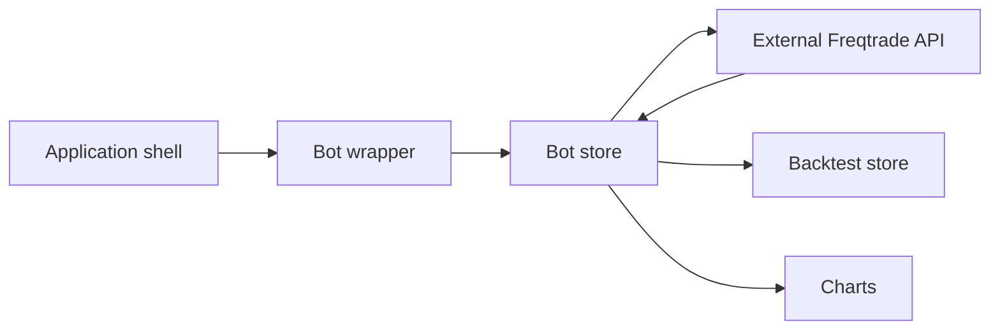
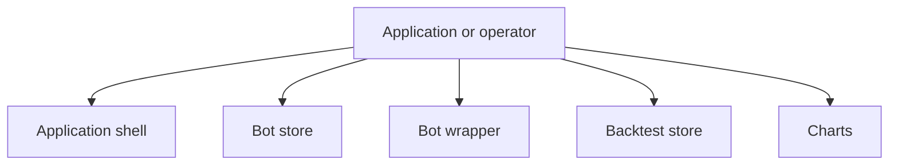
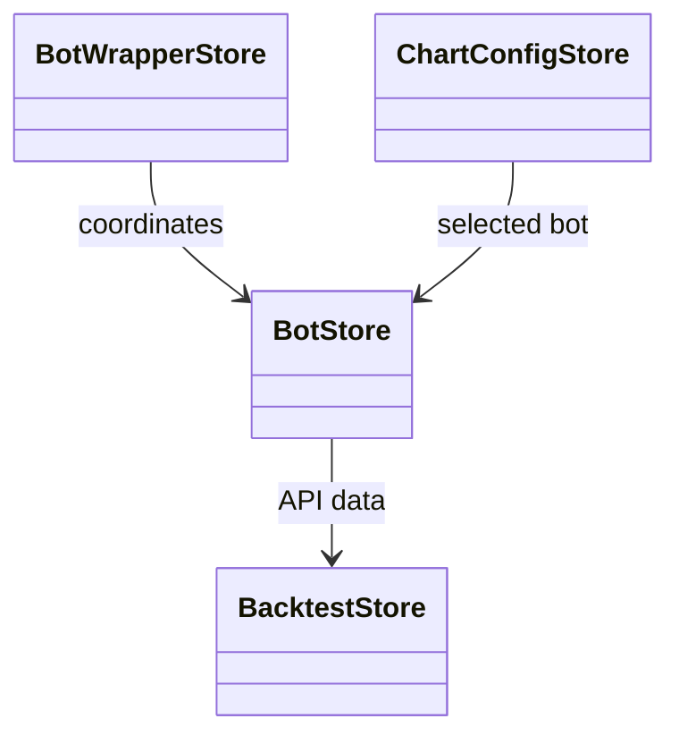
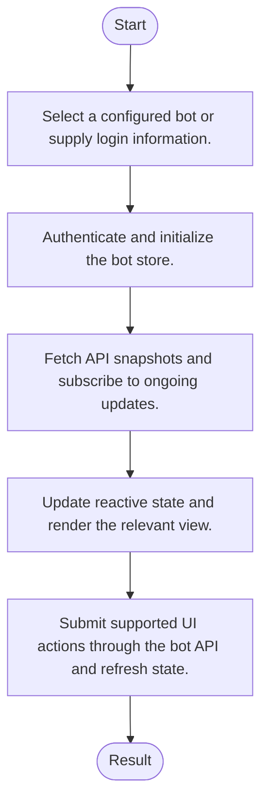
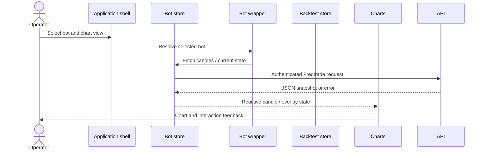
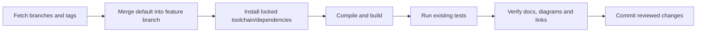

# frequi: architecture, features and workflows

Updated: 2026-10-12 · Branch: `feature/ayu_develop` · Source snapshot: `f6d8b38d`

[Development and layout](development.md) · [Validation evidence](validation.md) · [HTML edition](ayu-develop.html)

## Purpose and scope

A Vue web interface for Freqtrade. Pinia stores manage bot authentication, API data, chart configuration and backtest state; Vue views and components present trades, charts, performance, pairlists and bot settings.

## Features

- Multiple bot connections with persisted login and selection.
- Live trade, balance, profit, log and chart views.
- Historical backtest analysis and visual result comparison.
- Pairlist configuration, downloads and background job tracking.
- Vitest unit tests and mocked Playwright browser journeys.

## Components and responsibilities

| Component | Responsibility | Implementation |
| --- | --- | --- |
| Application shell | Hosts the Vue application and routed views | [src/App.vue](../src/App.vue) |
| Bot store | Manages a bot connection, API calls and received state | [src/stores/ftbot.ts](../src/stores/ftbot.ts) |
| Bot wrapper | Coordinates multiple configured bot stores | [src/stores/ftbotwrapper.ts](../src/stores/ftbotwrapper.ts) |
| Backtest store | Tracks backtest selection and analysis state | [src/stores/btStore.ts](../src/stores/btStore.ts) |
| Charts | Displays candles, indicators and trade overlays | [src/components/charts/CandleChart.vue](../src/components/charts/CandleChart.vue) |

## Architecture and boundaries

The following view shows the principal responsibilities and their data-flow relationship. It is a conceptual architecture view; each implementation link above identifies the owning source. Native or external services retain their own lifecycle and configuration.



### Component ownership

The boundaries below distinguish entry points from their state/model and integration responsibilities. Data validation, numerical semantics and external protocol handling belong in the owning modules rather than in documentation or deployment scripts.



## Types and relationships

The following schema is conceptual: this repository uses modules/reactive stores, shared service contracts or dataset metadata rather than implementing these as a class hierarchy. Source ownership is given in the component table.



## Runtime workflow

1. Select a configured bot or supply login information.
2. Authenticate and initialize the bot store.
3. Fetch API snapshots and subscribe to ongoing updates.
4. Update reactive state and render the relevant view.
5. Submit supported UI actions through the bot API and refresh state.



## Sequence of a typical operation

This sequence expands the responsibility flow described above. The named participants correspond to the component table; error handling and any service-specific prerequisites remain part of the implementation.



## Development and verification workflow

Sync the upstream refs, merge the actual default branch into `feature/ayu_develop`, resolve conflicts, install the documented environment and run the existing build/test commands. Keep lockfiles and source changes together so another checkout can reproduce the environment.



### Commands

```sh
pnpm install --frozen-lockfile
pnpm build
pnpm typecheck
pnpm test:unit --run
pnpm exec playwright test --project chromium
```

The exact commands executed, interpreter/compiler versions, pass/fail counts and any prerequisites are recorded in [validation.md](validation.md). A syntax-only pass is reported separately from a package/native build and from runtime tests.

## Source navigation

These links refer to files in this checkout. They remain useful when the repository is opened locally; the source snapshot above identifies the revision used for this guide.

- [src/App.vue](../src/App.vue)
- [src/stores/ftbot.ts](../src/stores/ftbot.ts)
- [src/stores/ftbotwrapper.ts](../src/stores/ftbotwrapper.ts)
- [src/stores/btStore.ts](../src/stores/btStore.ts)
- [src/components/charts/CandleChart.vue](../src/components/charts/CandleChart.vue)
- [e2e/analysis.spec.ts](../e2e/analysis.spec.ts)
- [e2e/backtest.spec.ts](../e2e/backtest.spec.ts)
- [e2e/chart.spec.ts](../e2e/chart.spec.ts)
- [e2e/dashboard.spec.ts](../e2e/dashboard.spec.ts)
- [e2e/downloadData.spec.ts](../e2e/downloadData.spec.ts)
- [e2e/helpers.ts](../e2e/helpers.ts)
- [e2e/login.spec.ts](../e2e/login.spec.ts)
- [e2e/logs.spec.ts](../e2e/logs.spec.ts)
- [e2e/pairlists.spec.ts](../e2e/pairlists.spec.ts)
- [e2e/settings.spec.ts](../e2e/settings.spec.ts)
